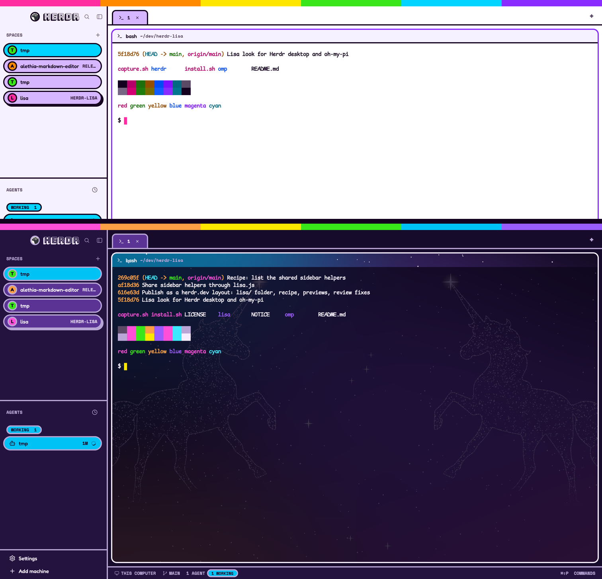

# herdr-lisa

The [Lisa](https://www.billyhunt.com/design-systems/lisa/) design system for the
[Herdr](https://herdr.dev) desktop app and [oh-my-pi](https://omp.sh), as one
look: neon fills under ink, 3px edges, pills, a spectrum strip, and Bungee
Shade, Fredoka, Space Mono and Comic Mono.



## Install

```sh
git clone https://github.com/billyhunt/herdr-lisa.git
cd herdr-lisa
./install.sh
```

Open Herdr at least once first (it creates `~/.config/herdr-app`). The first run
copies everything into place, sets oh-my-pi's light and dark themes, and
switches Herdr to the `lisa` layout. Later runs (after `git pull`) update the
files and leave your current layout and themes alone.

## What you get

| Herdr layout | Look | oh-my-pi theme |
|---|---|---|
| `lisa` | Day: paper page, lilac sidebar and pane headers, white terminal | `lisa-day` |
| `lisa-airbrush` | Dusk: midnight panels; behind the terminal, an airbrushed sky with two stardust unicorns | `lisa-dusk` |

`Cmd/Ctrl-Shift-L` cycles Herdr's layouts. oh-my-pi picks its light or dark
theme from the terminal's background, so it follows the layout by itself.

Pills show status everywhere (spaces, agents, folder tabs):

| Status | Pill |
|---|---|
| Working | cyan |
| Needs you | magenta, lemon NEEDS YOU chip |
| Done, not yet seen | lime |
| Idle | soft violet |

A space's circle is its project's colour, picked from its git repo (shared by
worktrees and second checkouts) or folder. The selected item has a hard shadow.

## What's in here

| Path | What it is |
|---|---|
| `lisa/` | The Herdr layout, laid out like Herdr's home (`~/.config/herdr-app`); also the folder herdr.dev/layouts lists. `RECIPE.md` describes it in full. |
| `lisa/layouts/` | `lisa.json`, `lisa-airbrush.json` and their settings previews |
| `lisa/themes/` | `lisa-day.json`, `lisa-dusk.json` (custom tokens `fill_1`…`fill_7`, `on_fill_<n>`, `accent_text`) |
| `lisa/mods/lisa-*` | Restyled copies of Herdr's `spaces`, `agents`, `tabs`, `pane`, `workspace-chrome`, `workspace-status` |
| `lisa/lisa-kit/lisa.js` | The shared helper; `install.sh` copies it into each mod (Herdr mods can't import across folders) |
| `lisa/fonts/`, `lisa/backgrounds/` | Loaded by Herdr from its home |
| `omp/themes/` | oh-my-pi's `lisa-day` and `lisa-dusk`, installed to `~/.omp/agent/themes/` |

## Changing it

Edit live in `~/.config/herdr-app` (Herdr hot-reloads) or `~/.omp/agent/themes`,
then run `./capture.sh` to copy the changes back here and commit. After editing
`lisa-kit/lisa.js`, copy it into every `mods/lisa-*` folder (`capture.sh` warns
if they differ). Check a mod with `herdr-app check ~/.config/herdr-app/mods/<mod>`.

The `lisa-*` mods are copies of Herdr 0.1.11's shipped mods, so Herdr updates
don't reach them. To pick up a new Herdr feature in one, clone the new stock mod
(`herdr-app do mod.clone '{"name":"tabs","as":"tabs-new"}'`) and port the Lisa
styling across. Herdr's stock search picker keeps its own space colours, so its
avatars don't match the sidebar's project colours.

## Licence

Apache License 2.0 (`LICENSE`), like Herdr, whose mods these are derived from;
see `NOTICE`. Fonts keep their own licences: Bungee Shade, Fredoka and Space
Mono under the SIL Open Font License (`lisa/fonts/OFL-*.txt`), Comic Mono under
MIT (`lisa/fonts/LICENSE-comicmono.txt`).
