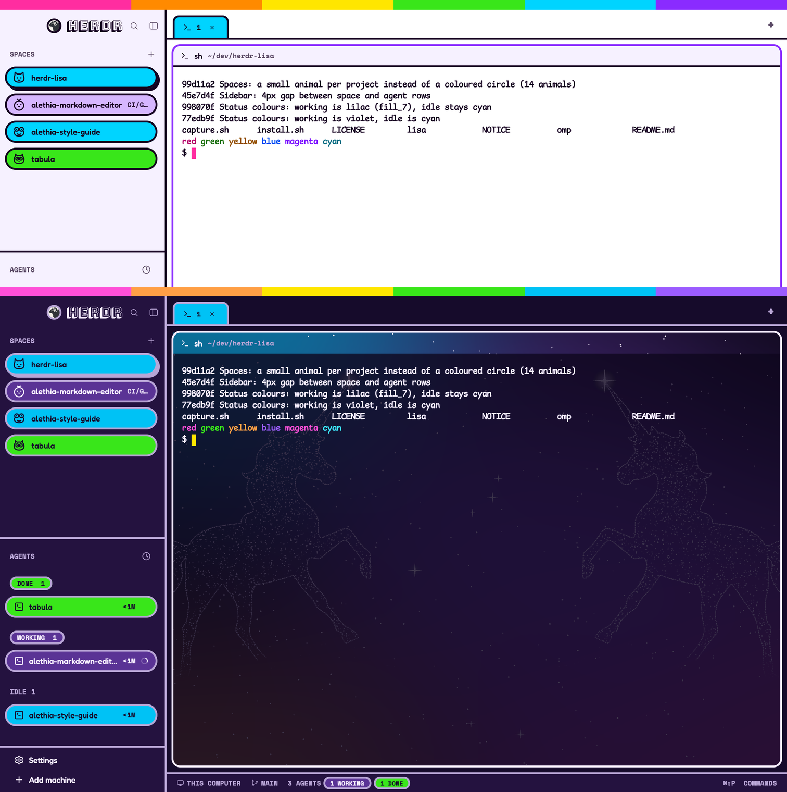

# Lisa

A neon, 90s school-supplies look for Herdr, after the
[Lisa design system](https://www.billyhunt.com/design-systems/lisa/): neon fills
under ink, 3px edges everywhere, pill-shaped rows and buttons, a six-colour
spectrum strip across the top, and colour that always means something. Two
layouts: `lisa` (Day: paper and lilac) and `lisa-airbrush` (Dusk: midnight
panels over an airbrushed sky).

## What you see

Top to bottom, left to right, in both layouts:

- **Spectrum strip**, 16px, full width: six solid bands, magenta `fill_1`,
  tangerine `fill_2`, lemon `fill_3`, lime `fill_4`, cyan `fill_5`, violet
  `fill_6`. It drags the window.
- **Sidebar**, 268px, `chrome` background, 3px `border` divider on its right.
  - Brand row, 52px: the Herdr logo in a 24px circle with a 3px edge, then
    "HERDR" in Bungee Shade 22px; search and sidebar-toggle as 28px round
    buttons.
  - SPACES and AGENTS lists, split by a 3px rule. Section labels are Space Mono
    bold capitals, 11px, `muted`.
  - Every space and agent is a 36px pill (`rounded_full`, 3px `border` edge)
    filled with its status (below). The selected or focused one has a hard
    4px offset shadow in the edge colour; nothing else marks selection.
  - A space's 24px avatar circle shows its initial, filled from fills 1 to 6
    by a hash of its git repo root (shared by worktrees and second checkouts),
    else its folder: a project keeps its colour everywhere.
  - Agent groups are chips: `WORKING 1`, `NEEDS YOU 2`, `DONE 1`, `IDLE 3`.
  - Footer, 75px: Settings and Add machine as 32px pills; an `UPDATE` lemon
    chip when an update waits (a lemon dot on the rail).
- **Tab bar**, 48px, `canvas` background over a 3px rule: tabs are folder tabs
  (rounded tops, 3px edges, square bottoms on the rule), Space Mono capitals,
  filled with the tab's status; the active tab stands 36px tall, others 30px.
- **Panes**, 8px apart and inset, 14px radius, 3px `border` frame, 3px `ring`
  frame when focused. A 34px header (program icon, Fredoka title, Space Mono
  path, `NEEDS YOU`/`DONE` chips) sits over the terminal.
  - `lisa`: the header is a lilac `chrome` strip over a 3px rule, the terminal
    a white field below it, like a folder card.
  - `lisa-airbrush`: the header is see-through and the terminal is 55% opaque,
    so a midnight sky with violet, magenta, cyan and orange glows and sparkles
    (`backgrounds/lisa-airbrush.png`) shows behind both.
- **Status bar**, 32px, `chrome`, 3px rule above: Space Mono capitals, `THIS
  COMPUTER`, branch, `1 AGENT`, count chips, and the palette hint.
- **Fonts**: Fredoka (UI, Medium for names), Comic Mono (terminal, 14px),
  Space Mono (labels), Bungee Shade (wordmark only).

| Token | Day (`lisa-day`) | Dusk (`lisa-dusk`) |
|---|---|---|
| canvas / chrome | `#FFFFFF` / `#F6F1FF` | `#160B2B` / `#24123F` |
| foreground / muted / border | `#14001F` / `#5B4A66` / `#14001F` | `#F6EEFF` / `#B9A6D6` / `#B9A6D6` |
| terminal background | `#FFFFFF` | `#0E061D` |
| fill_1..6 | `#FF2DA0 #FF8A00 #FFE600 #39E61A #00D4FF #8A2BFF` | `#FF4FD8 #FF9F45 #FFE600 #39E61A #00C2F5 #9B5CFF` |
| fill_7 (idle) | `#D6B6FF`, ink text | `#5A3395`, starlight text |

## How it behaves

- **Working**: cyan pill/tab; a spinner in the on-fill colour.
- **Blocked** (needs you): magenta pill/tab with a lemon `NEEDS YOU` chip.
- **Done**, not yet seen: lime pill/tab.
- **Idle** (and plain shells): soft violet (`fill_7`), so resting work recedes
  and live states stand out.
- Clicks, drags, reordering, pins, peeks, folding, the right-click menus, the
  agent sort popup and all keys behave as Herdr's stock mods do. Hover lights
  round buttons cyan with a 3px edge.
- The sidebar folds to a rail (76px on macOS, 60px elsewhere) showing avatars
  and status pills only.
- `Cmd/Ctrl-Shift-L` cycles layouts; the pair is `lisa` and `lisa-airbrush`.

## Built from

- `layouts/lisa.json`, `layouts/lisa-airbrush.json`: a clone of Herdr 0.1.11's
  `main` layout with root `type: column` (the `spectrum` row of six blocks with
  `background: "fill_n"`, then a `body` row holding `sidebar` and `work`). Root
  look: `theme` `lisa-day` / `lisa-dusk`, `font` Comic Mono 14, `ui_font`
  Fredoka, `traffic_lights` `[12, 32]` (below the strip). `lisa-airbrush` adds
  `terminal_opacity: 0.55`, a pane `background` image, and header props
  `{ "look": "glass" }`.
- `themes/lisa-day.json`, `themes/lisa-dusk.json`: standard colours plus custom
  tokens `fill_1`..`fill_7`, `on_fill`, `on_fill_6`, `on_fill_7`, `accent_text`,
  `code_bg`, `code_text`; mods read them through `theme()`.
- `mods/lisa-spaces`, `lisa-agents`, `lisa-tabs`, `lisa-pane`,
  `lisa-workspace-chrome`, `lisa-workspace-status`: restyled clones of the
  shipped mods (same commands, same `herdr` calls). Each carries an identical
  `lisa.js` (source `lisa-kit/lisa.js`): `fill`, `onFill`, `statusFill`,
  `label`, `chip`, `row`, `lift`, `roundButton`, and the sidebar helpers
  `findNode`, `narrow`, `toggleSidebar`. Mods can't import across folders,
  hence the copies.
- `fonts/`: Bungee Shade, Fredoka (Regular, Medium, SemiBold, Bold), Space
  Mono, Comic Mono, with licences. `backgrounds/lisa-airbrush.png`, 2400x1600.
- Shipped mods it still uses unchanged: `files`, `changes`, `new-menu`, `menu`,
  `picker`, `machine-add` (and their icons, e.g. `mods/files/file.svg`).
- Companion oh-my-pi themes live outside this folder (`../omp/themes`).

## Watch out

- Gradients render dimmed in Herdr 0.1.11 (about 65% brightness), so the strip
  is six solid bands, not a gradient. A layout `background` accepts theme token
  names, including custom ones like `fill_3`.
- A theme's top-level `background` is the terminal's. Stock mods paint some
  text in `foreground` on `background`, so a dark terminal under ink panel text
  goes invisible; the pane header uses `chrome` for that reason.
- `herdr-app check` renders with a stock theme that has no `fill_n` tokens;
  `lisa.js` falls back to stock colours so checks pass. Never read `t.fill_n`
  directly.
- Variable fonts load at their default weight only; ship static weights.
- Fredoka has no Black weight; `font_black()` falls back to Bold.
- Comic Mono has no `π`; the terminal falls back for that glyph.
- With `terminal_opacity` below 1, art shows only where programs leave the
  background empty; solid backgrounds (tool blocks, status lines) cover it.
- The stock `picker` keeps its own space colours (`space.colors`), so its
  avatars don't match the sidebar's project colours.

## Done when

- `herdr-app check` passes for all six `mods/lisa-*` and `herdr-app status`
  shows no errors after `layout.switch {name: "lisa"}` and `"lisa-airbrush"`.
- An agent working shows a cyan pill in Spaces, Agents and its folder tab and a
  `1 WORKING` chip in the status bar; blocked turns them magenta with `NEEDS YOU`.
- An idle space is soft violet; reordering spaces doesn't change avatar colours.
- In `lisa` the pane header is lilac over a white terminal; in `lisa-airbrush`
  sparkles show through the header and around terminal text.
- The rail fold keeps avatars whole at 60px and 76px.
